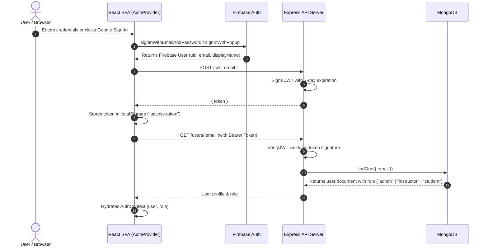
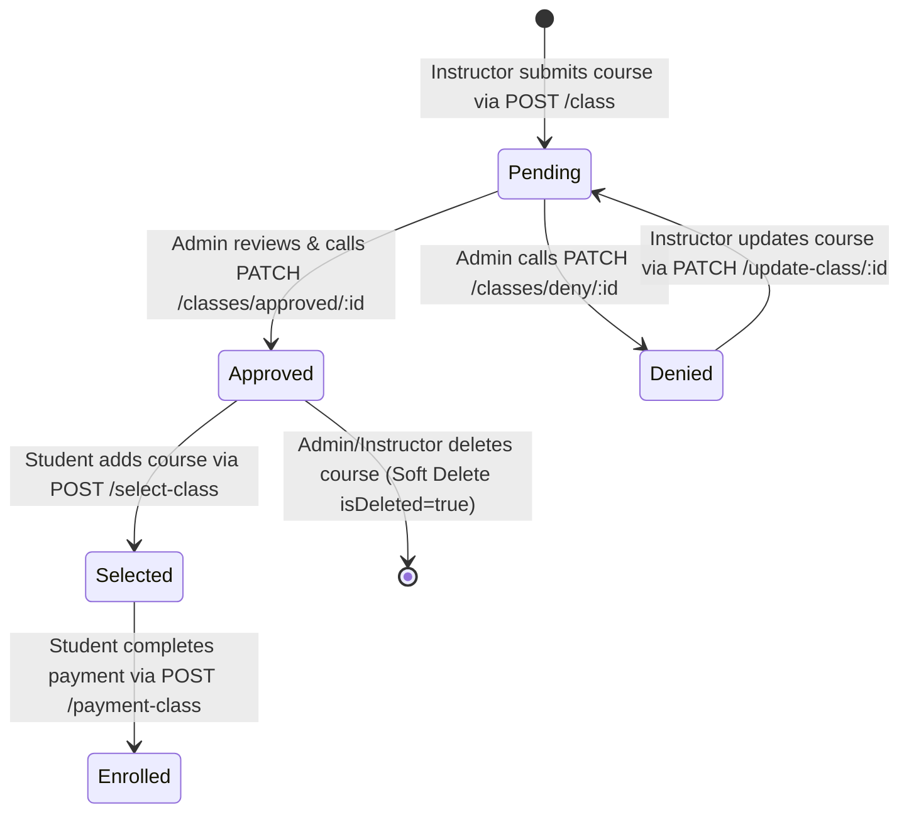
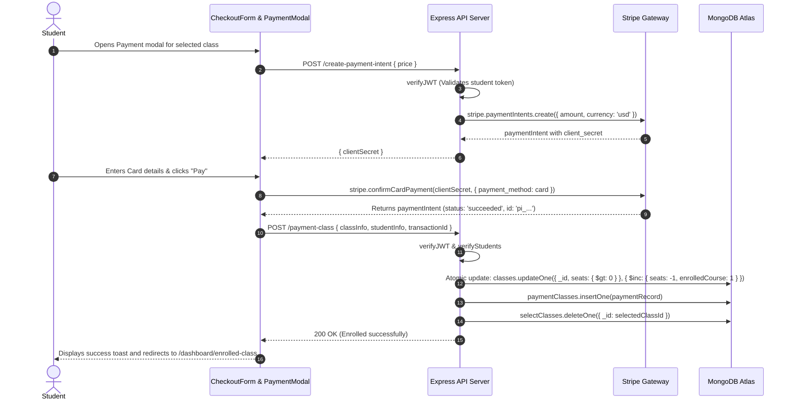

# Artistry Academia - System Architecture & Engineering Blueprint

This document specifies the software architecture, data modeling, component boundaries, asynchronous flows, and design patterns governing **Artistry Academia**.

---

## 1. High-Level System Architecture

Artistry Academia follows a decoupled client-server architecture:
- **Client Tier**: A responsive React 18 Single Page Application (SPA) bundled with Vite, styled with Tailwind CSS & DaisyUI, and using TanStack React Query for server state management.
- **Identity Tier**: Firebase Authentication managing user credential storage, password verification, and Google OAuth federated sign-in.
- **API Tier**: A stateless Node.js / Express.js REST API providing business logic, role-based authorization, and resource persistence.
- **Database Tier**: MongoDB Atlas managing document collections with replica-set consistency.
- **Payment Tier**: Stripe PaymentIntents API coordinating secure card transactions.
- **Media Tier**: ImgBB API providing cloud asset storage for user avatars and course media.

```mermaid
graph TD
    Client["Client SPA: React 18 / Vite / DaisyUI"]
    FirebaseAuth["Firebase Auth (Identity & Google OAuth)"]
    Server["API Server: Node.js / Express.js"]
    MongoDB[("MongoDB Atlas (Database Collections)")]
    Stripe["Stripe Payments API"]
    ImgBB["ImgBB Image Hosting"]

    Client -->|1. Sign in / Sign up| FirebaseAuth
    FirebaseAuth -->|2. Returns User Identity| Client
    Client -->|3. POST /jwt (Issue Session Token)| Server
    Server -->|4. Signs JWT Token| Client
    Client -->|5. Authorized REST calls with Bearer Token| Server
    Server -->|6. CRUD Queries & Aggregations| MongoDB
    Client -->|7. Image Uploads| ImgBB
    Client -->|8. Create PaymentIntent| Server
    Server -->|9. Initialize PaymentIntent| Stripe
    Client -->|10. Confirm Card Payment| Stripe
    Client -->|11. POST /payment-class (Record & Decrement Seat)| Server
```

---

## 2. Authentication & Authorization Flow

The platform uses a hybrid security model:
1. **Identity & Credential Handling**: Managed securely off-server by Firebase Authentication.
2. **Session & API Authorization**: Handled on-server via stateless HMAC SHA-256 JWTs signed with `ACCESS_TOKEN_SECRET`.



---

## 3. Class Lifecycle State Machine

Classes progress through strict administrative approval stages:



---

## 4. Class Enrollment & Payment Workflow

Payment follows Stripe's recommended two-step PaymentIntent pattern:



---

## 5. Security Architecture & Threat Mitigations

| Threat Vector | Mitigation Strategy |
| :--- | :--- |
| **Privilege Escalation** | `PUT /users/:email` uses field-whitelisting (`name`, `image`, `photoURL`, `profession`, `location`, `plan`, `phone`) and `$setOnInsert` for role assignment (`student`). Role modification is restricted to dedicated Admin routes (`/users/admin/:id`, `/users/instructor/:id`). |
| **IDOR in Class Management** | `PATCH /update-class/:id` checks `existingClass.instructor.email === req.decoded.email`. `DELETE /delete-class/:id` requires the caller to be the class owner or an admin. |
| **IDOR in Student Selections** | `DELETE /select-class/:id` and `GET /selected-class` enforce `studentInfo.email === req.decoded.email`. |
| **Race Conditions in Enrollment** | `POST /payment-class` uses atomic filter `{ seats: { $gt: 0 } }` with `$inc: { seats: -1, enrolledCourse: 1 }` to prevent over-enrollment. |
| **CORS Exploitation** | Strict origin validation verifies against approved domains (`localhost`, Vercel, Firebase Hosting) while maintaining secure credential transfer. |
| **Data Loss from Deletions** | User and class deletions execute soft deletes (`{ $set: { isDeleted: true } }`), preserving referential data integrity and audit trails. |
