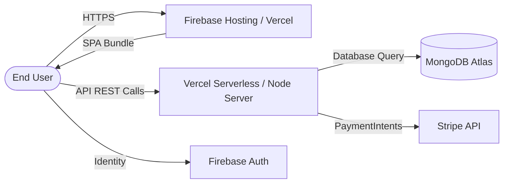

# Artistry Academia - Production Deployment Guide

This guide details the deployment architecture, configuration steps, and environment checklists for running **Artistry Academia** in production.

---

## 1. Deployment Topology

- **Frontend Client**: Deployed on **Firebase Hosting** or **Vercel** as a static Single Page Application.
- **Backend API**: Deployed on **Vercel** using `@vercel/node` Serverless Function runtime (`vercel.json`) or a Node.js container (Render, Railway, DigitalOcean).
- **Database**: **MongoDB Atlas** M0/M10+ Managed Cluster.
- **Third-Party Integrations**: Stripe API (Live/Test keys), Firebase Authentication, ImgBB Cloud API.



---

## 2. Server Deployment (Vercel)

The server includes a pre-configured [`server/vercel.json`](../server/vercel.json):

```json
{
  "version": 2,
  "builds": [
    {
      "src": "/index.js",
      "use": "@vercel/node"
    }
  ],
  "routes": [
    {
      "src": "/(.*)",
      "dest": "/",
      "methods": ["GET", "POST", "PUT", "PATCH", "DELETE", "OPTIONS"]
    }
  ]
}
```

### Steps:
1. Push the `server` repository to GitHub:
   ```bash
   cd server
   git push origin main
   ```
2. In the Vercel Dashboard, import `artistry-academia-server`.
3. Configure Environment Variables in **Project Settings -> Environment Variables**:
   - `PORT`: `5000` (Defaults to 5000)
   - `DB_USER`: MongoDB Atlas database username
   - `DB_PASS`: MongoDB Atlas database user password
   - `ACCESS_TOKEN_SECRET`: Long cryptographic random secret (e.g. `openssl rand -hex 64`)
   - `PAYMENT_SECRET_KEY`: Stripe secret key (`sk_live_...` or `sk_test_...`)
   - `CLIENT_URL`: Client production domain (e.g., `https://artistry-academia.web.app`)
4. Trigger Deployment.

---

## 3. Client Deployment (Firebase Hosting)

The client includes [`client/firebase.json`](../client/firebase.json) configured for single-page routing:

```json
{
  "hosting": {
    "public": "dist",
    "ignore": ["firebase.json", "**/.*", "**/node_modules/**"],
    "rewrites": [
      {
        "source": "**",
        "destination": "/index.html"
      }
    ]
  }
}
```

### Steps:
1. Set production environment variables in `client/.env.local` or GitHub Actions:
   ```env
   VITE_APIKEY=AIzaSy...
   VITE_AUTHDOMAIN=artistry-academia.firebaseapp.com
   VITE_PROJECTID=artistry-academia
   VITE_STORAGEBUCKET=artistry-academia.appspot.com
   VITE_MESSAGINGSENDERID=338977914212
   VITE_APPID=1:338977914212:web:...
   VITE_API_URL=https://artistry-academia-server.vercel.app
   VITE_IMGBB_KEY=a5f43b...
   VITE_Payment_Gateway_PK=pk_live_... (or pk_test_...)
   ```
2. Build the optimized production bundle:
   ```bash
   cd client
   npm run build
   ```
3. Deploy to Firebase:
   ```bash
   npm install -g firebase-tools
   firebase login
   firebase deploy --only hosting
   ```

---

## 4. Production Security Checklist

- [x] **Zero Vulnerabilities**: Ensure `npm audit` returns 0 vulnerabilities across client and server.
- [x] **CORS Whitelisting**: Verify `CLIENT_URL` is set on server so cross-origin requests are accepted.
- [x] **Firebase Authorized Domains**: Add your production domain (e.g. `artistry-academia.web.app`, custom domain) in Firebase Console under **Authentication -> Settings -> Authorized Domains**.
- [x] **Stripe Webhook Signatures**: Verify live mode Stripe API keys are configured and matching.
- [x] **MongoDB Atlas IP Whitelist**: In Atlas Network Access, allow access from anywhere (`0.0.0.0/0`) or specific Vercel outbound IP ranges.
